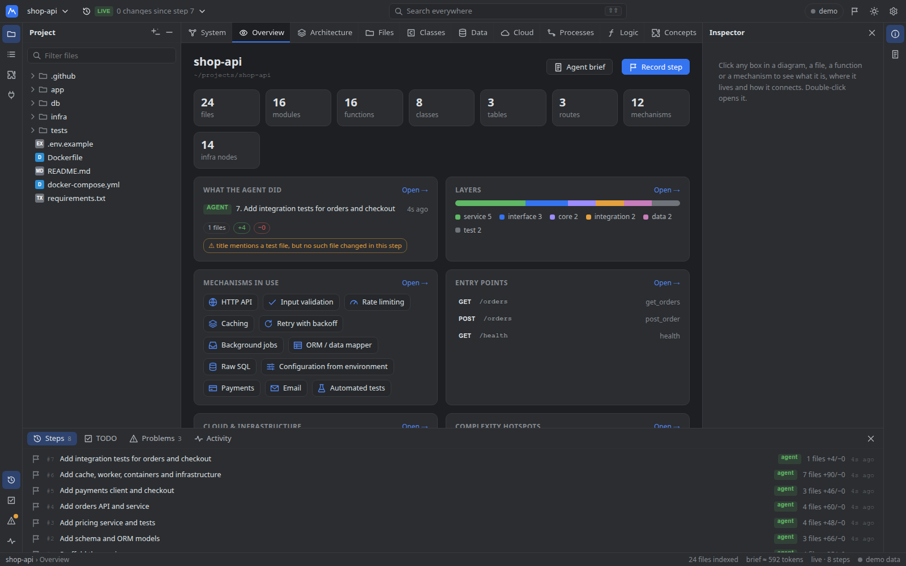
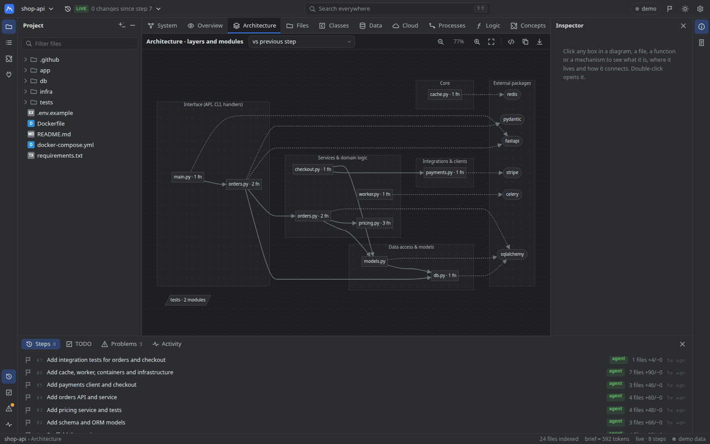
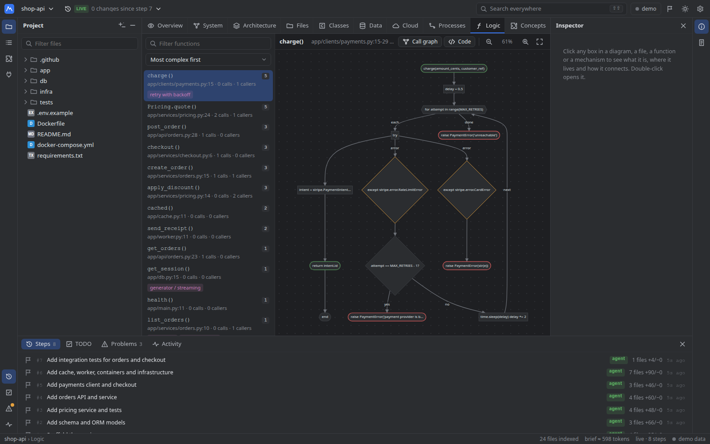
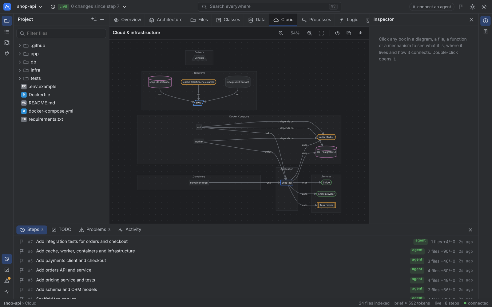
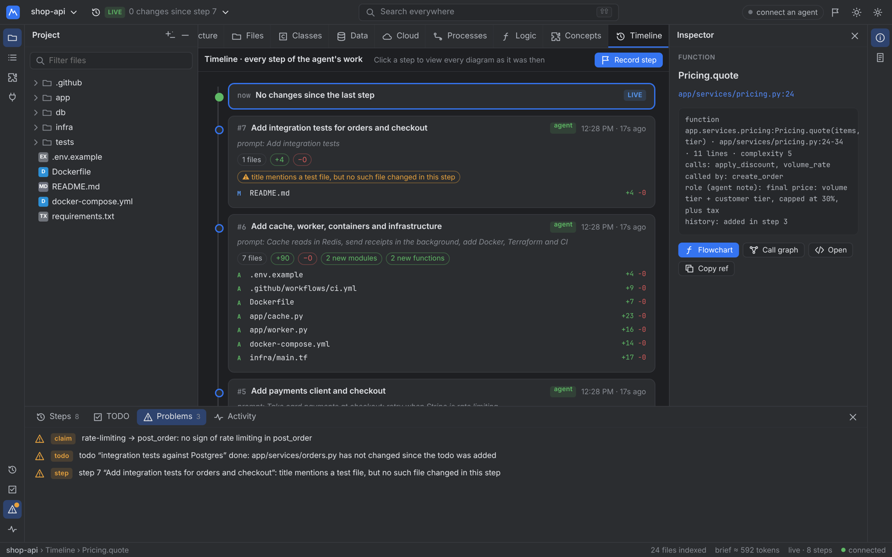

<p align="center"></p>
<h1 align="center">Mapwright</h1>
<p align="center"><b>A live map of what your coding agent is building.</b><br>
Structure, architecture, data model, cloud, API flows, logic and every step, drawn from the code as the agent writes it,<br>
and readable by the agent itself for a fraction of the tokens.</p>

<p align="center">
<a href="https://pypi.org/project/mapwright-agent/"></a>


<a href="LICENSE"></a>

</p>

<p align="center">
<a href="https://mapwright.pages.dev">Website</a> · <a href="https://mapwright.pages.dev/app/?demo">Live demo</a> · <a href="#quickstart">Quickstart</a> · <a href="#what-you-see">What you see</a> · <a href="#how-it-keeps-token-cost-low">Token cost</a> ·
<a href="#no-cheating">Verification</a> · <a href="#works-with">Works with</a> · <a href="docs/SETUP.md">Setup &amp; deploy guide</a> · <a href="docs/COMMANDS.md">Commands</a>
</p>

> **Beta.** Mapwright is ready for testing and feedback. The core (tracking, verification, MCP tools, hooks, the map UI) is
> stable enough for daily use; expect rough edges in the UI and in JS/TS analysis. Please
> [report what you find](https://github.com/1mystic/Mapwright/issues).

<p align="center"></p>

## Why

When an agent builds a project, you get files. You do not get the picture: how the pieces fit, what
talks to the database, which mechanisms it used, what changed in each turn, and whether what it says
it did is what it actually did. And the agent itself spends a large share of its tokens rediscovering
the same structure by listing directories and reading files.

Mapwright watches the code, not the agent's description of it. It builds the map with static
analysis, keeps a version of every file at each step, and gives the agent a compact text view of the
map so it can stop exploring. The agent's only job is to say when a step is done and what the plan
is; everything else is computed, and everything it claims is checked.

## Quickstart

```bash
pipx install mapwright-agent          # zero dependencies, Python 3.10+; the command is `mapwright`
cd your-project
mapwright init --connect claude-code  # baseline + MCP server + hooks for this project
mapwright open                        # the map in your browser
```

Then work with your agent as usual. Other agents: `mapwright connect --list`.

Other ways to install: `pipx install git+https://github.com/1mystic/Mapwright.git` (latest), or a wheel from the
[releases](https://github.com/1mystic/Mapwright/releases). The PyPI name `mapwright` belongs to an unrelated project, hence `mapwright-agent`.

- **Keep history inside the project:** `mapwright init --local` (see [Commands](docs/COMMANDS.md)).
- **Big repo?** `init` suggests folders to ignore (generated code, data shards); `.gitignore` is respected by default.
- **Use the hosted site:** `mapwright open --web` opens [mapwright.pages.dev](https://mapwright.pages.dev), which talks to your local Mapwright; your code never leaves your machine.
- **Stop it:** `mapwright down`; remove an agent with `mapwright disconnect`. [All the ways](docs/COMMANDS.md#stopping-mapwright).
- **Forget or rotate:** `mapwright forget` stops tracking this project (`--purge` also deletes its history); `mapwright token --rotate` writes a new API token, then restart the daemon and run `mapwright open`.

Full guide, including the VS Code extension: [docs/SETUP.md](docs/SETUP.md).

## What you see

An IDE-style interface (dark and light), live while the agent works, with every view also available
at any earlier step:

| View | Shows | Built from |
|---|---|---|
| **Overview** | Counts, what the agent just did, layers, mechanisms, entry points, infrastructure, hotspots, plan, verification | everything below |
| **System** | The whole system as one abstract, icon-based picture (clients → interface → logic → data → outside services, plus platform); click a component for what is inside it | layers, routes, tables, infrastructure |
| **Architecture** | Modules grouped into layers (interface, services, data, integrations, UI …), imports, external packages | Python `ast`, JS/TS imports |
| **Files** | How the project is organised, with added and changed files marked | the file tree |
| **Classes** | Classes, attributes, methods, inheritance and "uses" links | Python, JS/TS |
| **Data** | Tables, columns, keys and relations | SQL (also inside code strings), SQLAlchemy, Django, Prisma, zod schemas, Firestore/Storage collections with their security rules |
| **Cloud** | Containers, services, databases, caches, queues, buckets, functions, CI, external APIs | Dockerfile, compose, Terraform, Kubernetes, serverless, CI, `.env.example`, SDK imports |
| **Processes** | Each HTTP route → handler → the functions it calls → the tables they touch | routes (FastAPI, Flask, Express, Next.js), call graph |
| **Logic** | Every function by complexity, with algorithm hints, and a flowchart of its control flow | Python `ast` (JS/TS: outline), React components and hooks tagged |
| **Concepts** | Mechanisms in use (29 kinds: caching, retries, queues, auth, rate limiting, ORM, LLM calls …) with evidence in the code | the concept catalog |
| **Timeline** | Every step: what was asked, files changed with diffs, design changes, verification | the step store |

Overview opens first. The System view pans and zooms like the other diagrams (wheel at the cursor, drag,
double-click to fit). <kbd>Ctrl</kbd>/<kbd>Cmd</kbd> + <kbd>=</kbd> / <kbd>-</kbd> / <kbd>0</kbd> zooms the whole interface.

Click any box to inspect it; double-click to open the code, the flowchart or the call graph. Search
everything with <kbd>⇧</kbd><kbd>⇧</kbd>. The bottom panel holds steps, todos, problems and the agent's activity.

<table>
<tr><td></td>
<td></td></tr>
<tr><td></td>
<td></td></tr>
</table>

## How it keeps token cost low

The agent never draws a diagram, writes a summary or lists files. It uses a few small tools:

| Tool | The agent sends | It gets back |
|---|---|---|
| `map` | nothing (or a folder to expand) | The whole map in about 600 tokens: layers, modules and key symbols, routes, tables, infra, mechanisms, algorithms, open todos, recent steps. No source code. |
| `find` · `symbol` | a name | Where it is; its callers, callees, tables, routes and history. No source code. |
| `step` | a title, e.g. "Add refunds" | A receipt of what actually changed (files, lines, new and changed functions, classes, tables) |
| `todo` | the plan, then "done" with evidence | Whether the evidence really changed |
| `claim` · `note` · `link` | an id from the catalog and a symbol | Whether the code backs it up |

All nine tool definitions together are under 3,000 characters, because they are sent with every request.
The diagrams, icons, layouts and flowcharts are built by Mapwright from the code, so the agent spends
no output tokens on them.

## No cheating

Nothing the agent says is taken at its word:

- **What changed in a step is computed** from the files, not reported by the agent.
- **A step title is checked** against the changes: "Add tests" with no test file changed is flagged.
- **A todo marked done needs evidence** (a symbol or file) that changed after the todo was added.
- **A claimed mechanism must be visible in the code** of the symbol it names (`retry-backoff` on a function
  with no retry loop is "unverified").
- **Notes and links go stale** when the code they point at disappears.

Everything that does not check out appears under **Problems**, in the agent's own `map`, and in exports.

## Architecture rules

`mapwright.toml` in the project root (commit it) states what the code may depend on:

- **Forbidden imports** between layers or path globs, for example "the UI does not import the data layer".
- **No import cycles** between modules.
- **Limits** on complexity per function and on module size.

Violations appear in **Problems** and in the agent's `map`, and are checked at every step. `mapwright check`
lists them and exits 1 when one is broken, so CI or a pre-commit hook can fail on it. `mapwright rules --init`
writes a starter file that holds for the code as it is today.

```toml
[[forbid]]                     # an import that must not exist
from = "ui"                    # a layer name or a path glob
to = ["data"]                  # layers or globs
reason = "UI goes through services"

[limits]
no_cycles = true               # import cycles between modules
max_complexity = 25            # per function
```

Full reference: [Architecture rules in the commands guide](docs/COMMANDS.md#architecture-rules).

## Validation

Measured on this release (Python 3.13, Linux):

| | |
|---|---|
| Real agent run | Claude Code 2.1.325, headless, two turns (85 agent turns in all) building a URL shortener from an empty folder, then adding rate limiting and a stats endpoint, with Mapwright connected through `mapwright init --connect claude-code`. Tool calls: `todo` 23, `step` 9, `claim` 8, `map` 3, `symbol` 1, `catalog` 1, against 26 file writes and edits and **1 file read**. Result: 9 steps with correct computed changes, 11 of 11 todos verified, 8 of 8 claims verified, 0 problems. |
| What the real run fixed | It surfaced two false alarms, both fixed in this release: tables created in SQL strings were missed (a step about tables was flagged), and camelCase names like `TokenBucketLimiter` did not count as evidence (4 honest claims showed as unverified). Stored warnings are re-checked with the current analysis, so the fixes apply to history too. |
| Scripted session | 7 turns building an order service; the deliberately dishonest 7th turn produced exactly 3 problems (wrong step title, unearned todo, unbacked claim) and nothing else. |
| Dogfooding | Mapwright maps its own repository (`mapwright init --local --connect claude-code`). Its architecture rules file `mapwright.toml` is committed. |
| Tests | 125 passing (analysis, flowcharts, infra, tracking, verification, MCP over stdio, hooks, config writers, daemon API, the full session). |
| Speed | First scan of an 84-file repository 0.8 s; a new process starts warm in 0.01 s (cached by content hash). |
| Size | No runtime dependencies. Wheel about 1 MB, mostly the bundled diagram renderer. |

## Works with

| Agent / editor | How | Command |
|---|---|---|
| Claude Code | MCP server + hooks (prompts, edits, turn ends → automatic steps), or the plugin | `mapwright connect claude-code` |
| Cursor | MCP server | `mapwright connect cursor` |
| VS Code (Copilot agent mode) | MCP server, plus the extension for the map beside your code | `mapwright connect vscode` |
| Windsurf · Gemini CLI · Codex CLI · opencode · Claude Desktop | MCP server (opencode also has a plugin for automatic steps) | `mapwright connect <id>` |
| Cline · Roo · Zed · JetBrains AI | MCP config to paste | `mapwright connect --print <id>` |
| Anything else | File watching: steps close after a quiet period; the agent can use the CLI | `mapwright watch` |

For agents that support Agent Skills, `integrations/skills/mapwright/SKILL.md` teaches the workflow with
the MCP tools or, without MCP, the same through the shell.

## Privacy

Everything runs on your machine. The daemon listens on `127.0.0.1` only and needs a token. Secret-looking
files (`.env`, keys, credentials) are tracked as "changed" but never read. Code shown in the UI and in diffs
is passed through redaction. Nothing is sent anywhere. The optional hosted site is static: it only runs in your browser and calls your own local daemon (exact-origin allowlist plus the token); no code or history is uploaded.

## Limits

- Static analysis: dynamic imports, metaprogramming and tables created at runtime are not seen. Algorithm
  hints are hints.
- Routes are found for FastAPI, Flask, Express-style routers, Next.js and React Router (config arrays, `<Route>` JSX, `lazyGroup`-style helpers; shown as `PAGE`), not for hand-written `http.server` handlers. Route arrays built dynamically or mounted under a layout in another file show only their own paths.
- Firestore and Cloud Storage rules (`firestore.rules`, `storage.rules`) and static `collection()`/`doc()` calls appear as `firestore:`/`storage:` collections with allowed operations; paths built at runtime, and Firestore use from Python, are not seen. SQL inside content strings (e.g. quiz text) can still be reported as tables; SQL found only in tests, examples, scripts or vendored code is kept out of the map.
- Structure is drawn for Python, JS/TS, SQL and Prisma. Other languages are tracked for changes but not drawn.
- JS/TS flowcharts are an outline (branches and calls in order), not a full parse.
- Beta caveats: the UI and the System view's arrows (illustrative, not verified dependencies) are still being polished; Safari blocks the hosted site from reaching `127.0.0.1`, use `mapwright open` there.
- Steps close at turn ends only with hooks (Claude Code, opencode); elsewhere the agent calls `step` or a quiet period closes it.
- The VS Code extension was packaged and checked for syntax here, not exercised inside an editor.

## Roadmap and feedback

Planned: a native Ubuntu `.deb` and macOS app, polish of the System view, more languages. See [docs/ROADMAP.md](docs/ROADMAP.md) and the
[changelog](CHANGELOG.md). Bugs, ideas and traces from real projects are very welcome in [issues](https://github.com/1mystic/Mapwright/issues);
running `mapwright doctor` first and pasting its output helps.

## Project layout

```
src/mapwright/        analysis, tracking, MCP server, hooks, daemon, CLI, UI
integrations/         VS Code extension (.vsix included), Claude Code plugin, opencode plugin, Agent Skill
web/                  website (landing, docs, setup) + scripts/build_site.py builds the live demo
docs/                 SETUP, COMMANDS, AGENT_PROTOCOL, ARCHITECTURE, ROADMAP, RELEASING
scripts/              demo_session.py (scripted agent), build_site.py
tests/
```

MIT licensed. The diagram renderer is [Mermaid](https://mermaid.js.org) 10.9.3 (MIT), bundled.
